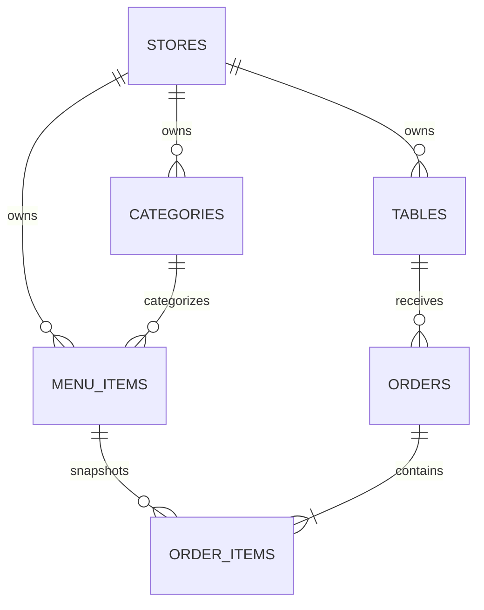

# Quản lý bán hàng & Gọi món tại bàn qua QR Code (Japanese Restaurant)

Khách quét QR trên bàn bằng điện thoại → xem menu món Nhật → gửi order. Nhân viên thấy đơn **realtime**, xử lý theo luồng:
`Chờ xác nhận → Đã nhận → Đang làm → Đã phục vụ → Thanh toán`.

**Stack:** Node.js 20+ · Express · Socket.io · PostgreSQL (`pg` Pool) · Zod · JWT · Multer — React 18 · Vite · Zustand.

---

## Chạy nhanh

### Bước 1: Khởi động cơ sở dữ liệu PostgreSQL
Có sẵn file `docker-compose.yml` trong thư mục `qr-order/`:
```bash
cd qr-order
docker compose up -d
```
*(Hoặc dùng PostgreSQL cài trên máy / cloud và chỉnh `DATABASE_URL` trong file `.env`).*

### Bước 2: Chạy Backend
```bash
cd qr-order/backend
# Copy file cấu hình (nếu chưa có)
cp .env.example .env      # Trên Windows PowerShell: Copy-Item .env.example .env
npm install
npm run db:init           # Cập nhật schema/migrations; chỉ seed nếu DB chưa có store
# Hoặc: npm run db:reset  # Để làm mới và nạp lại menu từ đầu
npm run dev               # http://localhost:4000
```

### Bước 3: Chạy Frontend (Mở Terminal mới)
```bash
cd qr-order/frontend
npm install
npm run dev               # http://localhost:5173 (tự động bật trình duyệt)
```
*(Trong VS Code / IDE: bạn cũng có thể bấm phím **F5** để tự động mở ứng dụng trên trình duyệt).*

---

## Hướng dẫn trải nghiệm & Đăng nhập

- **Trang nhân viên & quản lý:** `http://localhost:5173/staff`
  - Quản lý: tài khoản `admin` / mật khẩu `admin123`
  - Nhân viên: tài khoản `staff` / mật khẩu `staff123`
- **Trang chủ / Chọn ngôn ngữ:** `http://localhost:5173/` hỗ trợ song ngữ **Tiếng Việt / English**.
- **Quản lý Bàn & QR:** Vào mục **Bàn & QR** (`/staff/tables`) bằng tài khoản `admin` để xem, tạo bàn và in mã QR.
- **Quét QR bằng điện thoại cùng mạng Wi-Fi:**
  - Đặt `CUSTOMER_APP_URL` trong file `backend/.env` thành IP máy tính trong mạng Wi-Fi (ví dụ: `http://192.168.1.102:5173`).
  - Thêm IP đó vào `CORS_ORIGINS`.
  - Khách dùng điện thoại quét mã QR sẽ vào thẳng trang gọi món của bàn tương ứng.
- **Load test (kiểm tra tải):** `npm run test:load` (mặc định 50 khách đồng thời gửi order cùng lúc; hoặc `CONCURRENCY=100 npm run test:load`).

---

## Kiến trúc dự án

```text
Git repository root/
├── .vscode/
│   └── launch.json               # Cấu hình phím F5 tự mở trang web
├── package-lock.json             # Lockfile gốc
└── qr-order/
    ├── .gitignore
    ├── README.md
    ├── docker-compose.yml        # Docker compose khởi chạy PostgreSQL 16
    ├── backend/
    │   ├── .env.example
    │   ├── package.json
    │   ├── db/schema.sql         # Cấu trúc bảng PostgreSQL
    │   ├── db/migrations/        # Migrations idempotent cho categories, products, tables/QR
    │   ├── scripts/
    │   │   ├── initDb.js         # Nạp schema & menu món Nhật (hỗ trợ --reset)
    │   │   └── loadTest.js       # Kịch bản test chịu tải WebSocket + REST
    │   └── src/
    │       ├── domain/orders/constants.js
    │       ├── application/
    │       │   ├── errors/AppError.js
    │       │   └── services/{auth,categories,menu,orders,products,tables}.service.js
    │       ├── infrastructure/
    │       │   ├── config/{database,env}.js
    │       │   ├── persistence/{auth,categories,menu,orders,products,tables}.repository.js
    │       │   ├── realtime/
    │       │   │   ├── handlers/{message,presence,system}.handler.js
    │       │   │   └── {publisher,socket}.js
    │       │   └── storage/productImages.js
    │       ├── presentation/http/
    │       │   ├── app.js
    │       │   ├── controllers/
    │       │   ├── dtos/
    │       │   ├── middlewares/
    │       │   └── routes/
    │       ├── main/{container,server}.js
    │       └── shared/utils/
    ├── docs/
    │   ├── database/schema.sql
    │   └── wireframe/
    └── frontend/
        ├── package.json
        ├── vite.config.js
        └── src/
            ├── api/
            ├── components/
            ├── hooks/
            ├── lib/
            ├── pages/
            └── stores/
```

---

## Các tính năng kỹ thuật & Tối ưu hiệu năng (≥ 50 user đồng thời)

### Real-time

```text
React (Socket.IO Client) ── WebSocket / polling ──┐
                                                  v
React (REST API) ───────────────────────────> Express + HTTP Server
                                                  │
                                                  └── Socket.IO Server
                                                      ├── JWT staff → room store:{id}
                                                      └── QR customer → room table:{id}
```

HTTP API và Socket.IO dùng chung HTTP server tại `PORT`. `CORS_ORIGINS` nhận danh sách origin
phân cách bằng dấu phẩy. Nhân viên xác thực bằng JWT handshake; khách dùng token QR. Event
`message:send` chỉ dành cho nhân viên cùng cửa hàng, tối đa 10 tin nhắn/10 giây và 1.000 ký tự/tin.
Tin nhắn chỉ broadcast tạm thời trong room cửa hàng, không lưu vào database. `server:status` phản hồi
trạng thái qua acknowledgement; `user:online`/`user:offline` phát khi trạng thái socket cuối cùng của
nhân viên thay đổi. `notification` phát khi có đơn mới. Dữ liệu thao tác đơn hàng vẫn đi qua REST API.

Kiểm thử kết nối, xác thực, room, presence, rate limit, status và reconnect:

```bash
cd qr-order/backend
npm test
```

### Categories, products và tables APIs

Các endpoint quản trị yêu cầu `Authorization: Bearer <JWT>` và được giới hạn theo `storeId`
trong token. Tạo/sửa/xóa là quyền `admin`; nhân viên cũng có thể đổi trạng thái món hoặc bàn.

| Module | Endpoints |
| --- | --- |
| Categories | `GET /api/categories` (page, limit, search, status, sort); `GET /api/categories/:id`; `POST`, `PUT /:id`, `DELETE /:id` |
| Products | `GET /api/products` (page, limit, search, categoryId, status, minPrice, maxPrice, sortBy, sort); `GET /:id`; `POST`, `PUT /:id`, `PATCH /:id/status`, `DELETE /:id` |
| Tables | `GET /api/tables` (page, limit, search, location, status); `GET /:id`; `POST`, `PUT /:id`, `PATCH /:id/status`, `DELETE /:id` |
| QR | `GET /api/tables/:id/qr`, `GET /:id/qr/download`, `POST /:id/qr/regenerate`; public verify: `GET /api/public/tables/verify/:token` |

Category/product/table deletes are soft deletes. Category deletion returns `409` while active products
still reference it; table deletion returns `409` while open orders exist. Product prices are stored as
integer VND in the existing PostgreSQL `INT` column to avoid floating-point rounding. Product images
are accepted as multipart field `image` (JPEG/PNG/WEBP, max 5 MB), checked by MIME and file signature,
stored under `UPLOAD_DIR/products` with random filenames, and served from `/uploads/products/`.

Postman collection: `backend/postman/qr-order.postman_collection.json`. Set its `baseUrl` and `token`
variables before sending protected requests.

Apply the idempotent schema migrations and run tests from `qr-order/backend`:

```bash
npm run db:init
npm test
```

The existing database uses integer IDs and `menu_items` for products; migrations extend those tables
without replacing data or changing the existing order-history foreign keys.



---

## Khi cần mở rộng thêm (Scale)

- **Chạy nhiều instance:** Thêm `@socket.io/redis-adapter` (room dùng chung) và thay `TtlCache` bằng Redis.
- **Triển khai Production:** Đặt sau Nginx/Caddy có HTTPS (camera điện thoại quét QR & PWA cần HTTPS), đặt `NODE_ENV=production`, dùng `JWT_SECRET` dài ngẫu nhiên, đổi mật khẩu tài khoản mẫu.
- **Tính năng có thể mở rộng tiếp:** Thanh toán trực tuyến (VNPAY/MoMo/ZaloPay), in bill qua máy in nhiệt (ESC/POS), thống kê báo cáo doanh thu theo ca.
